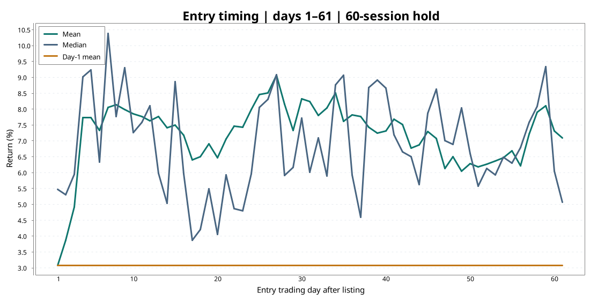
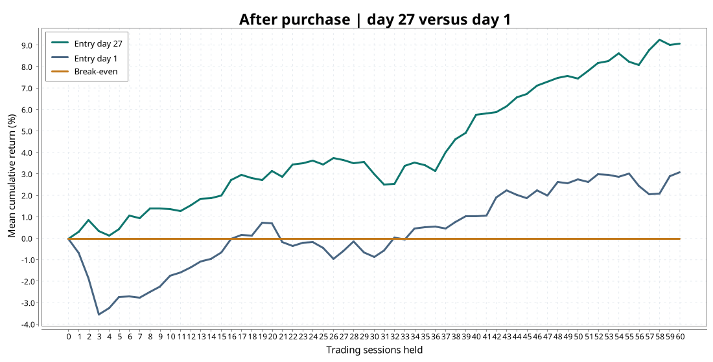
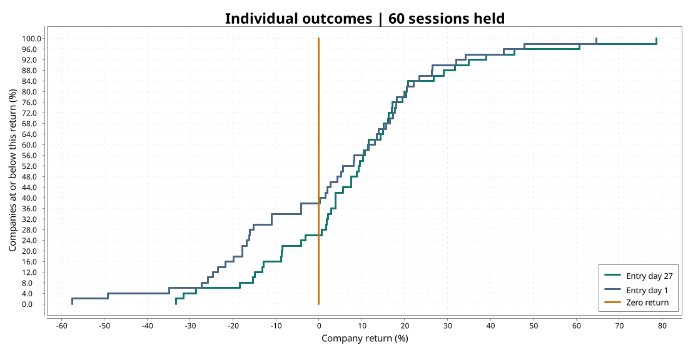

# Spin-off Entry Study

I built this while learning Scala through Aalto's O1 course. I was looking into UPM's planned WISA spin-off and wanted to check whether waiting after a spin-off could give me a better entry price.

The idea is that shareholders who receive shares in a new company might sell because they do not want to own it. I wanted to see whether historical returns showed any useful pattern around when to buy.

This project compares entry days across 50 real spin-offs. You choose how long to hold, and the program ranks entry days by their average return. It also shows the median, percentage of positive returns, worst result and difference from buying on day 1.

## Results

For the main comparison, I used a **60-session holding period** and tested **entry days 1–61**. That is the full range supported by the dataset: each company has 121 trading sessions of prices.



| Entry day | Average return | Median return | Positive returns | Difference vs day 1 |
|---|---:|---:|---:|---:|
| 1 | 3.08% | 5.47% | 62% | — |
| 5 | 7.74% | 9.24% | 58% | +4.65 pp |
| 10 | 7.85% | 7.26% | 68% | +4.77 pp |
| 20 | 6.48% | 4.07% | 58% | +3.40 pp |
| **27** | **9.08%** | **9.09%** | **74%** | **+5.99 pp** |
| 30 | 8.34% | 7.72% | 68% | +5.26 pp |
| 40 | 7.32% | 8.68% | 64% | +4.23 pp |
| 60 | 7.32% | 6.06% | 64% | +4.24 pp |

Differences are calculated before rounding. All days here are trading sessions.

### What I take from this

Waiting performed better than buying on day 1 on average in this sample. Day 27 had the highest average return, but I would not read this as a rule to buy on exactly that day. Days 5 and 10 already returned around 7.7–7.9%, and the graph has several peaks rather than one clear buying window.

At day 27, the mean and median were both around 9.1%, so the average was not just hiding a low median. Still, 13 of the 50 companies lost money and the worst return was **−33.16%**. Entering on day 27 beat entering on day 1 for **30 of the 50 companies** when both were held for 60 sessions.



The holding period changes the answer. I also tested 20- and 40-session holds over the same entry-day range:

| Sessions held | Best entry day | Average return | Day-1 average return |
|---|---:|---:|---:|
| 20 | 59 | 5.46% | 0.70% |
| 40 | 59 | 6.79% | 1.03% |
| 60 | 27 | 9.08% | 3.08% |

The 60-session result fits my original idea of buying around days 20–40, but the shorter holds do not. I cannot conclude that this window is consistently the best time to buy.



For me, this is a reason to investigate waiting rather than rushing into a spin-off on its first day. It does not tell me whether WISA is worth buying. I would still need to understand the business, its debt and its valuation. The next useful checks would be comparing returns against the market and testing an entry rule on a separate group of spin-offs.

## How the comparison works

For each company, return is:

```text
return = exit price / entry price - 1
```

I then take the average across the 50 companies, giving each company equal weight. Buying on day 27 and holding for 60 sessions means selling on day 87. Buying on day 1 means selling on day 61. The comparison therefore includes different exit dates as well as different entry prices.

The data covers 50 spin-offs selected based on available price history, so it is not a complete sample of all spin-offs. Prices are in euros; US prices are converted using ECB reference rates, so currency movements affect those returns. Dividends and trading costs are excluded.

The prices alone cannot show whether selling was forced or why prices moved. Also, the best day was selected using the same data used to measure its return. It is a historical result, not a tested trading rule.

## Run it

Open the project in IntelliJ with Scala 3 and run `spinoff.Main` from the project folder.

To reproduce the main comparison, enter:

```text
Holding period: 60
Last entry day: 61
```

The console prints the day-1 baseline, the five highest-ranked entry days and average returns at checkpoints after purchase. The charts above are saved images of the 60-session study; running the console does not regenerate them.

## Files

- `src/PriceRow.scala` — one company's price on one trading day.
- `src/CsvReader.scala` — reads the CSV into price rows.
- `src/EntryStudy.scala` — calculates individual and average return paths.
- `src/EntryRanking.scala` — compares entry days and calculates summary statistics.
- `src/Main.scala` — handles inputs and prints results.
- `data/real_spinoff_prices.csv` — 50 real spin-offs, 121 sessions each.
- [data/real_spinoff_sources.csv](data/real_spinoff_sources.csv) — listing dates, price sources and currency conversion notes.
- `data/fake_spinoff_prices.csv` — fake data for practice.
- `figures/` — saved charts shown in this README.
